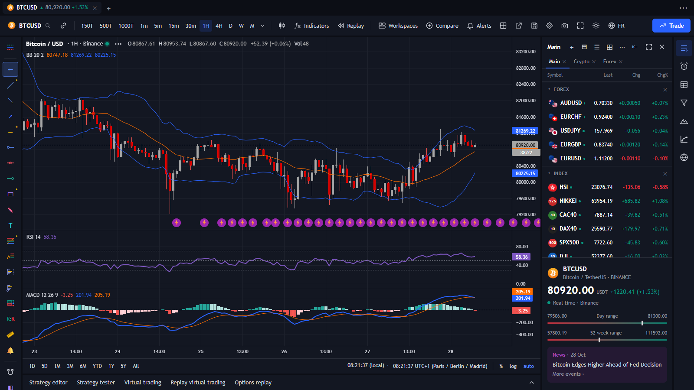
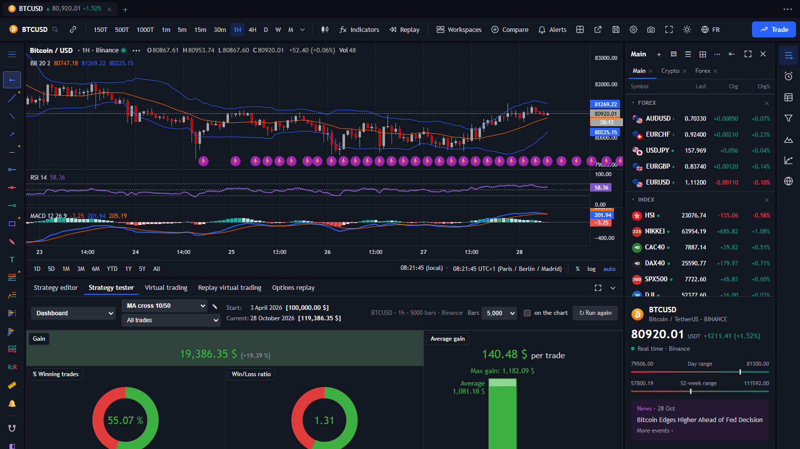
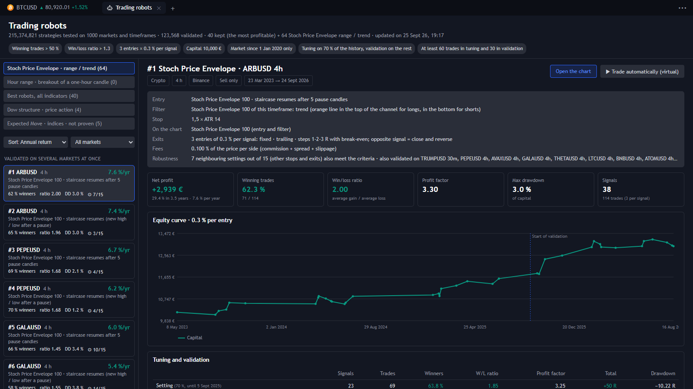
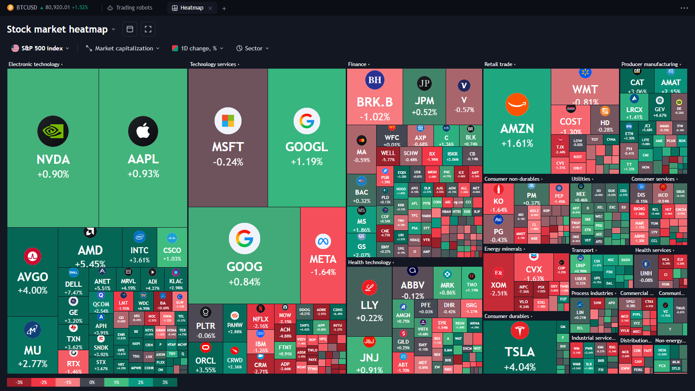
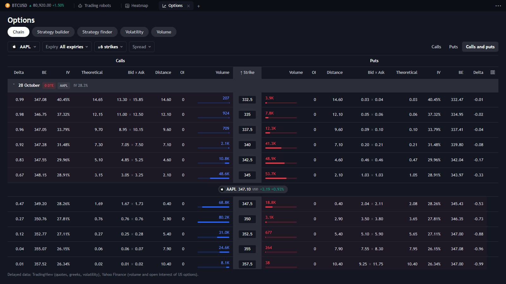

# TeshTerminal

*English version: [README.en.md](README.en.md)*

**Un terminal de trading gratuit, qui tourne chez soi dans le navigateur, façon TradingView.** Graphiques en direct (crypto, forex, indices, futures, actions), indicateurs et stratégies en Pine Script, testeur de stratégie, replay, trading virtuel et un labo qui teste des robots avec les vrais frais. React, TypeScript et Lightweight Charts™ de TradingView. Interface en français et en anglais.



| Testeur de stratégie | Robots de trading |
| --- | --- |
|  |  |
| **Carte thermique** | **Chaîne d'options** |
|  |  |

> **Avertissement** : projet personnel, pour apprendre et trader en virtuel. Ce n'est pas un conseil en investissement, aucun ordre réel n'est passé, et les résultats passés ne garantissent pas les résultats futurs. Les données viennent de sources publiques gratuites, parfois différées ou incomplètes. Sans lien avec TradingView, Binance, Yahoo ou Interactive Brokers.

## Lancer

Double-cliquer sur `lancer.bat` : le serveur démarre puis la plateforme s'ouvre dans Chrome en **mode application** (sans onglets ni barre d'adresse ; les fenêtres détachées aussi). Sinon :

```bash
npm install
npm run dev
```

puis ouvrir http://localhost:5173.

Les données Yahoo Finance passent par le proxy du serveur Vite (`/yf`, voir `vite.config.ts`) :
l'application doit donc être servie par `npm run dev` (ou `npm run preview`), pas ouverte comme simple fichier.

## Langue / Language

Bouton **EN / FR** (globe) en haut à droite : l'interface passe en anglais, la page se recharge et le choix est gardé (fenêtres détachées comprises). À la première ouverture, la langue suit celle du navigateur (français sinon anglais).

*The **EN / FR** button (globe icon, top right) switches the whole interface to English; the choice is remembered. On a first visit the language follows the browser. Documentation in English: [README.en.md](README.en.md).*

Les écrans restent écrits en français ; en anglais, les textes affichés sont remplacés à la volée d'après `src/i18n/en.json` (`texts` : textes entiers, `patterns` : textes avec des valeurs `{0}`, `{1}`… ; `null` = laisser tel quel). Les nombres et les dates suivent la langue (`LOCALE`, `DEC` dans `src/i18n/lang.ts`). Après avoir ajouté des écrans, lister les textes sans anglais :

```bash
node scripts/i18n-extract.mjs --broad
```

puis compléter `en.json` avec ce qu'il écrit dans `scripts/i18n-missing.json`. Un élément marqué `translate="no"` n'est jamais traduit.

## Sources de données

| Marché | Source | Mise à jour |
| --- | --- | --- |
| Crypto (paires USDT) | Binance (REST + WebSocket, sans clé) | temps réel |
| Graphiques en ticks (1T à 1000T), crypto | Binance spot `aggTrades` + WebSocket `aggTrade` | temps réel |
| Graphiques en ticks, or / argent / pétrole WTI / gaz / cuivre et ~160 actions et ETF américains (TSLA, NVDA, AAPL, SPY, QQQ…) | perpétuels « TradFi » de Binance Futures (`XAUUSDT`, `TSLAUSDT`…), libellé « Perpétuel Binance » | temps réel ; prix du contrat perpétuel, qui cote 24 h/24 et peut s'écarter du sous-jacent hors séance ; historique limité à 2 jours ; n'alimente pas la cotation du symbole |
| Actions, indices, forex, matières premières | Yahoo Finance | sondage toutes les 4 à 30 s, peut être différé selon la bourse |
| CFD indices d'Interactive Brokers : IBUS30, IBUS500, IBUST100, IBDE40, IBFR40, IBJP225, IBHK50 (section « CFD » de la liste principale) ; futures DAX, CAC 40, Hang Seng (DE40, FR40, HK50, section « Future ») | IB Gateway lancé sur ce PC (port 4001 ou 4002, ou TWS 7496 / 7497, trouvé tout seul ; « Read-Only API »), relayé par le serveur Vite (`/api/ib`, `scripts/ib-relay.ts`) | différé de 15 min sans abonnement IBKR, temps réel avec ; historique depuis 2012 ; rien si la Gateway est fermée ; DE40 et HK50 ont la même **estimation en temps réel** que les futures américains (ligne suivante), par BingX `NCSIGER2USD-USDT` et MEXC `HK50_USDT` |
| Indices cotés 23 h sur 24 : US30, US500, US100 (section « Future » de la liste principale) | futures CME réels (YM, ES, NQ) par IB Gateway, échéances mises bout à bout ; Yahoo (`YM=F`, `ES=F`, `NQ=F`) si la Gateway est fermée | temps réel avec le « US Securities Snapshot and Futures Value Bundle » d'IBKR (10 USD par mois, offert dès 30 USD de commissions dans le mois), sinon 10 min de retard, comblées par une **estimation en temps réel** : dernier cours CME différé × mouvement des perpétuels Binance (`SPYUSDT`, `QQQUSDT`), MEXC (`SPX500_USDT`, `US30_USDT`, via `/mexc`) et BingX (`NCSIDOWJONES2USD-USDT`, via `/bingx`) depuis cette minute (`src/data/feeds/futuresEstimate.ts`) ; pastille violette, bougies estimées en pâle, remplacées par les vraies au fil de l'eau ; écart médian mesuré sur 14 jours : ES 0,5 pt, NQ 2, YM 2,7 (contre 2,3, 15 et 16 avec le retard) ; s'arrête seule dès qu'IBKR passe en temps réel ; graphiques et liste seulement (robots, alertes et historique enregistré gardent les vraies barres) |
| US2000, J225 (section « Future ») | futures CME de Yahoo (`RTY=F`, `NIY=F`), échéance la plus proche | 10 min de retard, comblées par l'estimation en temps réel (BingX `NCSIRUSSELL20002USD-USDT` et `NCSINIKKEI2252USD-USDT` ; secours Binance `IWMUSDT` et MEXC `JP225_USDT`) : écart médian 0,25 pt sur RTY, 11 sur NIY (contre 1,1 et 55) ; cours au-dessus du cash du coût de portage ; DAX, CAC 40 et Hang Seng viennent d'Interactive Brokers (ligne au-dessus) |
| Tout le reste / hors ligne | simulateur local | bandeau « affichage simulé » |
| Info du symbole (secteur, site, séances) | Yahoo Finance `quoteSummary` via `/api/yinfo` (jeton géré par le serveur Vite) | à l'ouverture |
| FIGI | OpenFIGI (Bloomberg) via `/figi` | à l'ouverture |
| Courbes de rendement (taux souverains) | screener public TradingView via `/tvscan` (symboles `TVC:FR10Y`…) | toutes les 60 s |
| Screener d'actions (France, États-Unis, Allemagne…) | screener public TradingView via `/tvscan`, logos TradingView | toutes les 60 s |
| Macro Maps (inflation, taux, PIB…) | screener TradingView (`ECONOMICS:FRIRYY`…) ; historique : Banque mondiale (annuel), BRI (taux directeurs, mensuel) | à l'ouverture |
| Marchés, options (OPRA), graphiques fondamentaux, résultats et dividendes | screener public TradingView via `/tvscan` | toutes les 60 s / à l'ouverture |
| Calendrier économique | flux public ForexFactory via `/ffcal` (semaine en cours ; pas de valeur « actuel ») | toutes les 10 min |
| Flux d'actualités (dans la langue de l'interface) | TradingView `news-mediator` / `news-headlines` via `/tvnews` et `/tvstory` | toutes les 60 s |
| Scripts de la communauté | recherche TradingView via `/tvweb`, code source des scripts open source via `/tvpine` | à la demande |

Ticks : une barre = N transactions agrégées Binance, horodatée à la milliseconde (plusieurs barres par
seconde en 1T). Les transactions sont chargées par pages de 1000 alignées sur leur identifiant et gardées
en mémoire (400 pages) : les autres intervalles en ticks du même symbole et le testeur de stratégie les
réutilisent. Le chargement reste sous un budget de poids de requêtes par minute (spot 2400 sur 6000,
futures 1200 sur 2400) et s'arrête 30 s après un échec, pour éviter le bannissement de l'IP par Binance.
Les autres marchés (forex, indices, futures CME, actions hors États-Unis) n'ont pas de ticks gratuits :
ils sont simulés (bandeau explicite).

Unités de temps : ticks (Binance), secondes (Binance), minutes / heures / jours. Les unités qu'une
source ne fournit pas directement (45m, 2H, 3H, 10s…) sont reconstruites à partir d'une unité plus fine ;
pour les actions, les barres H sont alignées sur l'ouverture de séance comme sur TradingView.

Limites de l'historique Yahoo : 1 min = 30 jours, 5–30 min = 60 jours, 1 h / 4 h = 2 ans, journalier et plus = tout.

## Raccourcis

- Taper une lettre n'importe où : recherche de symbole
- Double-clic sur le graphique : échelle auto + retour à la dernière barre
- Molette sur l'axe des prix : zoom vertical
- Suppr : efface le dessin sélectionné, Échap : annule l'outil en cours
- Paramètres du graphique (roue dentée en haut) : compte à rebours avant la clôture de la bougie (activer / désactiver)

Graphiques : TradingView Lightweight Charts™, Copyright © 2025 TradingView, Inc., https://www.tradingview.com/
(le logo de la librairie est masqué sur les graphiques).

## Fenêtres détachées (plusieurs écrans)

- Bouton ↗ de la barre du haut, menu ••• › « Ouvrir dans une nouvelle fenêtre », ou ↗ sur une fenêtre du mode Libre :
  le graphique s'ouvre dans une vraie fenêtre du navigateur, à déplacer sur n'importe quel écran.
- Glisser un actif de la liste de droite **hors** du navigateur ouvre une fenêtre à cet endroit.
- « Disposition › Choisir l'écran… » ouvre directement sur un écran donné (Chrome demande une fois
  l'autorisation « Gestion des fenêtres »).
- Chaque fenêtre garde son propre état (symbole, unité, indicateurs, dessins) ; « Disposition » liste les
  fenêtres, les rouvre à leur place ou les ferme toutes. Autoriser les pop-ups pour localhost permet de
  toutes les rouvrir d'un coup.

## Mode Libre

Glisser un actif de la liste de droite dans la zone centrale ouvre une fenêtre à cet endroit ;
le déposer sur un graphique (mode 1, 2 ou 4 fenêtres) change le symbole de ce graphique.

En mode 2 fenêtres, 4 fenêtres ou Libre, chaque petit graphique reprend les indicateurs de la fenêtre
principale (celle du mode 1 fenêtre) : même liste, mêmes réglages et couleurs, calculés sur son propre
symbole et sa propre unité de temps. Ajouter, retirer ou régler un indicateur en mode 1 fenêtre change aussi
les petits graphiques. Chaque petit graphique a les mêmes légendes et commandes que le mode 1 fenêtre :
nom, OHLC et valeurs sous la croix, œil (masquer / afficher), code source, paramètres, suppression, et pour
les panneaux monter / descendre / réduire / agrandir / supprimer. Ce qui touche aux indicateurs (réglages,
masquer, réduire un panneau, supprimer) vaut pour toutes les fenêtres ; « agrandir » ne vaut que pour la fenêtre
où il est cliqué. Les petits graphiques s'ouvrent dans l'unité de temps de la fenêtre principale (15 min si
c'est une unité en ticks).

**⛶ (en-tête d'un petit graphique)** : l'affiche seul et en grand dans la fenêtre principale (mode 1 fenêtre), avec
son actif et son unité de temps. Une barre « ↩ Revenir aux fenêtres libres » (ou « aux 4 fenêtres ») ramène la
disposition d'avant ; ✕ la ferme pour rester en 1 fenêtre. Chaque petit graphique (Libre, 2 et 4 fenêtres) garde
son actif et son unité de temps quand on change de disposition et qu'on y revient.

Le clic droit sur un petit graphique (ou « ••• » dans sa légende) ouvre le même menu qu'en mode 1 fenêtre, pour
son propre actif et son dernier prix : alerte, indicateur, info du symbole, copier le prix, cacher les bougies de
ce graphique, ajouter à une liste, ouvrir dans une nouvelle fenêtre, configurations. Seule la note de texte n'y
est pas : les petits graphiques n'affichent pas les dessins.

## Couleurs du graphique et thèmes

- ⚙ Paramètres du graphique : chaque couleur (corps, contours, mèches, fond, grille) se choisit en un clic
  parmi 10 couleurs prêtes, ou dans le sélecteur complet (palette, couleur personnalisée, opacité).
  Ces 10 couleurs sont aussi en tête de tous les sélecteurs (indicateurs, dessins).
- Le thème clair et le thème sombre gardent chacun leurs couleurs : passer de l'un à l'autre retrouve les
  réglages laissés dans chaque thème. « Couleurs par défaut » remet celles d'origine du thème affiché :
  clair = bougies haussières grises à contour noir, baissières noires ; sombre = haussières grises,
  baissières rouges.
- Un modèle enregistré (💾) garde les couleurs des deux thèmes.

## Données hors ligne

Les barres de chaque graphique ouvert (historique, pages plus anciennes et temps réel) sont enregistrées
dans le navigateur (IndexedDB, environ 48 octets par barre). Sans connexion, les graphiques, le replay,
le testeur de stratégie et le screener utilisent ces données. Un bandeau l'indique, et un badge
« Hors ligne » apparaît dans la barre d'onglets. Une unité absente est reconstruite à partir d'une plus fine
(5m depuis 1m, 4H depuis 1H, semaine depuis jour). Le graphique repasse en direct dès le retour du réseau.
En ligne, quand la source n'a plus d'historique (Yahoo : 30 jours en 1 min), le défilement vers le passé
continue avec les barres enregistrées les jours précédents.

Les graphiques utilisent aussi l'historique du labo de robots (`robots/data`, servi par le serveur de
développement sous `/api/data/lab/page`) : pour un symbole et une unité qu'il contient (ou une unité plus fine
qui la divise : 2H depuis 1H, semaine depuis jour), le défilement vers le passé continue dans ses fichiers
une fois la source en ligne épuisée, par exemple le forex en 1 min depuis 2000 (HistData) derrière les
30 jours de Yahoo. En crypto, les fichiers Binance sont les mêmes barres que l'API : les pages anciennes sont
lues sur le disque dès que le fichier rejoint la dernière barre chargée, sans requête à Binance. Un fichier
ne prolonge le graphique que s'il rejoint la plus ancienne barre affichée (quelques jours d'écart au plus) :
un historique arrêté des années plus tôt (Euro Stoxx 50 de HistData, fini en 2019) n'est pas recollé. Sans
réseau, un graphique s'ouvre sur ce même historique s'il va plus loin que les barres enregistrées dans le
navigateur. Les fichiers des perpétuels Binance (`bnfut_`) ne servent qu'au labo.

••• (barre d'onglets) › **Données hors ligne…** : activer ou couper l'enregistrement automatique,
télécharger à l'avance l'historique de symboles de la liste dans plusieurs unités (jusqu'à 10 000, 50 000
ou 200 000 barres par série), voir et supprimer ce qui est enregistré. Les ticks et les secondes sont limités
aux 200 derniers blocs par série. L'application elle-même tourne en local (`npm run dev`), donc sans Internet.

## Infos de l'actif (comme TradingView)

**Sur le graphique**, en bas : **E** (résultats), **D** (dividendes), **⚡** (actualités). Au survol, une carte :
- **E** : date (☀ avant l'ouverture, ☾ après la clôture), période, BPA publié / estimé / surprise, revenu publié / estimé.
  Les prochains résultats sont en pointillés, à droite de la dernière bougie. « Voir tous les résultats » ouvre
  Graphiques fondamentaux sur la société (BPA).
- **D** : date ex-dividende, date de paiement, montant.
- **⚡** : les dernières actualités de l'actif (TradingView, dans la langue de l'interface), cliquables.
- Paramètres du graphique › « Événements en bas du graphique » : afficher ou non chaque type.

**Sous la liste de droite**, la fiche de l'actif : secteur et industrie, cours, plage du jour et sur 52 semaines,
dernière actualité, prochains résultats (date, BPA et revenu estimés), dividendes (ratio de paiement, rendement,
dernier paiement, dates), note des analystes (jauge, nombre d'analystes, objectif à 1 an). La ligne au-dessus de la
fiche se glisse vers le haut ou le bas pour agrandir la fiche ou la liste.

Sources : screener TradingView (fiche, derniers et prochains résultats, dividendes, analystes), Yahoo (tous les
dividendes, dates de résultats jusqu'à mi-2025, via `/api/yearnings`), Nasdaq (4 derniers résultats des titres cotés
aux États-Unis, via `/nasdaq`), fil d'actualités TradingView. Code : `src/data/assetInfo.ts`,
`src/components/ChartEvents.tsx`, `src/components/SymbolDetails.tsx`.

## Dessins : modèles et favoris

- ◧ dans la barre d'outils de gauche : modèles de dessin (outil + couleur + épaisseur + style de trait),
  ou ☆ dans la mini-barre d'un dessin sélectionné pour enregistrer son style.
- Clic droit sur un outil › Ajouter aux favoris ; ★ affiche la barre mobile des favoris (déplaçable par ⋮⋮).
- **Niveau de Fibo** : réglage par défaut (29 septembre) = niveaux 0, 0,382, 0,5, 0,618, 0,786, 0,88 et 1, une seule
  couleur bleue, lignes de 1 px en tirets, sans fond, valeurs des niveaux à gauche, sans les prix.
- **Outils en couleur** (29 septembre) : chaque famille d'outils a sa couleur dans la barre de gauche, la barre des
  favoris et les menus, avec une teinte plus foncée en thème clair. Segments et rayons en bleu ; lignes horizontales
  dans la couleur qu'elles tracent (jaune, bleu, rouge, vert) ; rectangle et modèles en violet ; pinceau en rose ;
  texte en cyan ; Fibonacci avec des niveaux colorés ; profils de volume en indigo, avec le POC en jaune ; positions
  en vert (objectif) et rouge (stop) ; règle jaune ; aimant rouge quand il est actif ; corbeille en rouge. L'outil
  actif prend un fond de sa couleur. Code : `tone` dans `src/components/toolInfo.ts`, classes `tone-…` dans `App.css`.
- **Aimant** (fer à cheval dans la barre de gauche), comme sur TradingView : les points d'un dessin se collent
  à l'ouverture, au plus haut, au plus bas ou à la clôture de la bougie sous la souris, et à l'heure de cette bougie.
  - Clic : active ou désactive ; clic droit : **aimant faible** (seulement quand la souris est à moins de 24 px
    d'un de ces prix) ou **aimant fort** (toujours le prix le plus proche). Pôles pleins sur l'icône = aimant fort.
  - Un anneau bleu montre où le point va se coller. L'aimant sert à poser un point et à déplacer un point d'un
    dessin ; pas au pinceau, au texte, ni au déplacement d'un dessin entier.

## Replay

Bouton **Replay** : cliquer sur une barre du graphique (ou 🎲 « Aléatoire » pour une date au hasard),
puis lecture / pause, avancer d'une barre (Maj + →), vitesse de 0,1x à 10x, « Temps réel » pour quitter.
Le replay garde sa date si on change d'unité de temps ou de symbole.

## Indicateurs personnalisés (Pine Script)

- Barre de droite › **Éditeur Pine** (ou Indicateurs › « Nouveau script Pine ») : coller un script Pine v5/v6,
  la compilation et un essai sur les 500 dernières barres se font en direct ; « Ajouter au graphique » (Ctrl+S enregistre).
- Pris en charge : `input.*`, `ta.*` (sma, ema, rma, rsi, stoch, macd, bb, atr, supertrend, pivots…), `math.*`,
  `color.*`, `var`, `if` / `for` / `while`, fonctions utilisateur, `plot`, `plotshape`, `plotchar`, `hline`.
- Stratégies (`strategy(...)`, `strategy.entry` / `exit` / `close`…) : voir « Testeur de stratégie » ci-dessous.
- Non pris en charge : `request.security`, tableaux (`array.*`), `switch`, types / méthodes.
  `bgcolor`, `fill`, `label`, `line`, `table` sont ignorés (avertissement affiché).
- Le bouton `{}` de la légende affiche le code ; « ✎ Modifier » le rouvre dans l'éditeur.
- Indicateurs intégrés écrits en TypeScript : `src/indicators/` (ex. `custom/stochPriceEnvelope.ts`).

## Mes indicateurs (portés de Pine Script)

Indicateurs › « Mes indicateurs » ; le bouton `{}` montre le script Pine d'origine et son portage.

- **Imbalance Personnalisé** : fair value gaps haussiers / baissiers en boîtes (couleurs, bordure réglables).
- **Imbalance** : blocs jaunes sur les déséquilibres de la bougie du milieu (transparence réglable).
- **HA** : bougies alternatives cyan / rouge par-dessus le graphique (régression linéaire, Heikin Ashi ou aucune).
  Pour ne voir qu'elles, masquer la série principale (menu ••• du symbole).
- **Sessions** : boîtes pointillées New York / Londres / Tokyo (horaires GMT+1 modifiables) avec plus haut / plus bas,
  en unités intraday uniquement.
- **Sto+RSI** : stochastique lent (K 200 lissé 3, D 200 vert / rouge selon la pente, niveaux 80 / 20) et RSI 14 (70 / 30).
- **Tsh_Arrow** : SuperTrend sur moyenne pondérée par le volume (WMA 20 par défaut, facteur 4), coloré selon un vote
  KNN (hausse / baisse / neutre), zone entre le SuperTrend et le milieu des bougies, pastilles de départ de tendance,
  triangles de signal et flèches ▲ / ▼ sur les croisements DEMA MACD (les 50 dernières, comme `label.new` sur TradingView).

Comme sur TradingView, les boîtes gardent les 500 plus récentes (`max_boxes_count`).

### Structure de marché (Dow) · price action

Créé pour la plateforme (pas de script Pine d'origine) : Indicateurs › « Mes indicateurs » › « Structure de
marché (Dow) ». Code : `src/indicators/custom/dowStructure.ts`.

- **Sommets et creux** : un sommet dépasse les N bougies de chaque côté (réglage « Force », 3 par défaut). Il n'est
  connu que N bougies plus tard, comme sur un vrai graphique. Étiquettes HH / HL (vert) et LH / LL (rouge).
- **Les deux niveaux** : le dernier plus haut et le dernier plus bas pas encore cassés (lignes en escalier).
- **Tendance** : une clôture franche au-dessus du plus haut la passe haussière, sous le plus bas baissière.
  Une clôture franche est une bougie dans le sens de la cassure, avec un corps d'au moins 50 % de sa hauteur
  (réglable). L'étiquette dit « BOS » quand la tendance continue, « CHoCH » quand elle se retourne. Fond vert
  ou rouge léger (transparence réglable).
- **Boîte de retracement** : la dernière bougie opposée à l'origine de la jambe qui a cassé le niveau, comme un
  bloc institutionnel (le plus bas de la montée, le plus haut de la baisse).
- **Entrée** au retour du prix dans la boîte, au contact ou sur une bougie de rejet (réglable). Flèche « Achat »
  ou « Vente ». Une boîte ne sert qu'une fois.
- **Stop** sous la boîte (au-dessus pour une vente), avec une marge de 0,1 ATR.
- **Objectif** : la prochaine liquidité, à au moins 1 R (réglable). C'est un equal high / low ou un sommet /
  creux pas encore pris.
- **Sortie** : flèche orange « Sortie · stop / objectif / retournement » avec le résultat en R. « Retournement »
  veut dire une clôture franche dans l'autre sens. Pour le trade en cours : lignes d'entrée, de stop et
  d'objectif.
- **Liquidité** : equal highs / lows (EQH / EQL), c'est-à-dire deux sommets ou creux ou plus à moins de 0,15 ATR
  (réglable). La ligne pointillée court jusqu'à ce que le prix la prenne. « Liquidité prise » si la bougie
  revient de l'autre côté du niveau.
- **Ranges** : les deux derniers sommets et les deux derniers creux sont chacun à moins de 0,5 ATR (réglable).
  Le range est tracé en boîte grise jusqu'à une clôture franche dehors.
- Rien ne lit le futur : l'indicateur calculé sur un historique coupé donne les mêmes flèches jusqu'à la coupe.
- **Options ajoutées pour l'étude de nuit** (même moteur que l'étude, `src/robots/dow.ts`, donc mêmes trades) :
  - **Signal d'entrée** :
    - « Retour dans la boîte après une cassure » ;
    - « Prise de liquidité puis retour ». Le prix prend un sommet / creux non pris (ou un equal high / low)
      d'une mèche et clôture de l'autre côté : entrée à contre-sens à la clôture, stop derrière la mèche.
  - **Boîte** :
    - dernière bougie opposée (bloc) ;
    - moitié de la jambe (50 %) ;
    - retour sous le niveau cassé, c'est-à-dire l'ancien range.
  - **Objectif** : prochaine liquidité, multiple fixe du risque, aucun (sortie au retournement), ou stop suiveur
    sous chaque nouveau creux (au-dessus de chaque sommet pour une vente), à la façon de Dow.
  - **Liquidité** :
    - pas de trade quand de la liquidité se trouve près du stop ;
    - stop placé au-delà de cette liquidité ;
    - ou seulement après une prise de liquidité (la jambe a d'abord chassé les stops).
  - **Autres réglages** :
    - stop au prix d'entrée après +1 R ;
    - impulsion minimale en ATR ;
    - durée de vie de la boîte.
  - **Filtres** :
    - heures actives (heure de Paris, par exemple « 8-12, 14-18 ») ;
    - sens de la tendance de l'unité supérieure (1 h, 4 h, jour, ou 20 bougies sur un graphique en ticks) ;
    - frais par côté (les résultats en R deviennent nets) ;
    - pas de trade quand les frais dépassent un pourcentage du risque ;
    - pas d'entrée quand le prix est dans un range.
  - **Bilan** près de la dernière bougie : nombre de trades, total en R et part de gagnants sur l'historique
    affiché (frais compris quand ils sont réglés).

### Indices : « Base future / cash » et « Gap d'ouverture »

Ces deux indicateurs marchent sur les indices de la liste principale, que le graphique montre le cash (SPX500, DAX40…), le future (US500, DE40…) ou le CFD (IBUS500, IBDE40…). Chaque indice est relié à ses deux autres versions dans `src/data/indexFamilies.ts`, avec les heures de sa séance cash et la règle d'échéance de son future.

**Base future / cash** (panneau) :
- **Écart** : future moins cash (ou moins le CFD, réglage « Comparer le future à »), en points ou en %. Bleu au-dessus de zéro (contango, ou report), orange en dessous (déport).
- **Écart théorique** : ce que coûte le portage jusqu'à l'échéance, cash × (taux − dividendes) × jours / 365. Taux et dividendes par défaut selon l'indice, réglables.
- **Prime** (optionnelle) : écart moins théorique.
- La légende résume la dernière valeur : contango ou déport en points et en %, portage annuel implicite, échéance et jours restants.
- L'autre série se charge en arrière-plan (`src/indicators/companion.ts`). Au-dessus de 15 min, l'écart se mesure sur des bougies de 15 min alignées (les bougies horaires du cash américain commencent à :30). Les bougies du cash hors séance, dont celle de l'enchère de clôture, ne comptent pas.

**Gap d'ouverture** (sur le prix) :
- Une zone entre la clôture de la veille et l'ouverture du cash, jusqu'au comblement (bordure pleine) ou jusqu'à la fin de la séance (pointillés), avec le texte « Gap +0,62 % · comblé en 45 min ».
- Toutes les séances chargées par défaut (réglage « Séances affichées », 0 = toutes) : en reculant dans le graphique, les gaps plus anciens apparaissent. Les textes qui se chevauchent sont masqués, les plus récents gardés.
- En journalier, sur le cash : chaque gap s'étend jusqu'au jour où il est comblé (« comblé après 3 j ») ou reste ouvert jusqu'à aujourd'hui (« toujours ouvert »). C'est le moyen de voir les gaps sur des années, l'intraday de Yahoo ne remontant qu'à 60 jours en 15 min.
- Sur la dernière séance : les chances de comblement mesurées par l'étude des gaps depuis 2020 pour cet indice, ce sens et cette taille de gap (dans l'heure, d'ici la clôture, temps médian).
- Hors séance :
  - sur le cash, l'**ouverture attendue** : sa clôture plus le mouvement du future depuis cette clôture ;
  - sur le future ou le CFD, le **gap du cash en formation**.
- Sur un future ou un CFD, seules les bougies des heures du cash comptent pour les séances.

## Réglages des indicateurs

Roue dentée d'un indicateur dans la légende : fenêtre comme sur TradingView.

- **Paramètres en entrée** : groupés et sur une ligne comme dans le script Pine (`group=`, `inline=`), horaires de session
  en deux champs heure.
- **Style** : pour chaque tracé, afficher / masquer, couleur **avec opacité** (palette, couleur personnalisée, curseur
  d'opacité) et épaisseur ; niveaux horizontaux des panneaux.
- **Visibilité** : unités de temps où l'indicateur est affiché (ticks, secondes, minutes, heures, jours, semaines, mois, avec plage).
- **Configurer ▾** : réinitialiser, enregistrer comme défaut (repris à chaque nouvel ajout), oublier le défaut.
- Les changements s'appliquent tout de suite ; **Annuler** (ou Échap) revient aux réglages d'avant l'ouverture.
- **Source** (SMA, EMA, WMA, ZLEMA, Bollinger, RSI, MACD, CCI, Momentum) : un prix (close, open, high, low, hl2, hlc3,
  ohlc4, hlcc4, volume) ou la courbe d'un autre indicateur du graphique, comme sur TradingView.

## Indicateur sur indicateur

- Bouton **ƒ+** dans la légende d'un indicateur : ajoute une moyenne, un Bollinger, un RSI… calculé sur sa courbe
  (choix de la courbe quand il y en a plusieurs, ex. MACD : histogramme, MACD ou signal).
- Une moyenne ou un Bollinger se place dans le panneau de sa source (moyenne du RSI dans le panneau du RSI) ; un
  oscillateur a son propre panneau (RSI de l'OBV).
- Le titre dit sur quoi il est calculé : « SMA 20 · RSI 14 », « BB 20 2 · MACD 12 26 9 (Signal) ».
- Supprimer la source supprime aussi les indicateurs calculés dessus.

## Alertes

Icône cloche de la barre de droite (ou bouton « Alertes » en haut).

- **Alerte de prix** rapide : prix tapé (vide = cours actuel), Alt+A, ou outil cloche de la barre de dessin. Le prix de
  l'actif est suivi même s'il n'est sur aucun graphique ni dans la liste ouverte.
- **Alerte sur indicateur, plusieurs conditions ou liste** (bouton du panneau, ou cloche 🔔 dans la légende d'un indicateur) :
  - sur un actif, ou sur chaque actif d'une liste de suivi (60 au plus), dans l'unité de temps choisie ;
  - jusqu'à 5 conditions, toutes sur la même barre ou au moins une ;
  - chaque condition compare le prix, une courbe d'indicateur ou une valeur : croise (à la hausse / à la baisse),
    supérieur / inférieur à, entre dans un canal / en sort / dedans / dehors, monte / baisse de X % en N barres ;
  - déclenchement : une seule fois, une fois par barre, ou à la clôture de la barre ;
  - sans expiration ou jusqu'à une date ; nom et message facultatifs ; notification Windows en option.
- Les indicateurs sont copiés dans l'alerte avec leurs réglages au moment de la création.
- Dans le panneau : état de chaque alerte (en veille, déclenchée N fois, arrêtée, expirée), ⏸ / ▶, ✎ pour la
  modifier, ✕ ; **Journal** des 300 dernières alertes déclenchées (clic sur l'actif pour l'ouvrir).
- Les alertes tournent tant que la plateforme est ouverte, même fenêtre réduite ou en arrière-plan. Plateforme fermée
  ou PC éteint : pas d'alerte.

## Panneaux d'indicateurs

- Glisser le séparateur entre deux panneaux pour les redimensionner (taille mémorisée)
- Boutons en haut à droite de chaque panneau : monter, descendre, réduire, agrandir, supprimer
- « Disposition des fenêtres › Redéfinir les tailles par défaut » remet les hauteurs d'origine
- Roue dentée d'un indicateur en panneau › Niveaux horizontaux : ajouter / retirer des lignes (ex. 80, 70, 30, 20)

## Barre latérale droite

Bandeau d'icônes comme TradingView, un panneau à la fois (largeur réglable par le bord gauche) :
liste de surveillance, alertes en cours, fenêtre de données (valeurs de la barre sous le curseur),
screener (listes CAC 40 / S&P / crypto…, tri, filtres, RSI journalier), éditeur Pine, courbes de rendement, Macro Maps.

- Bulle d'aide à gauche de chaque icône au survol.
- ⛶ en haut à droite de chaque module (à côté de ✕) : plein écran, comme sur TradingView (Échap pour revenir).
- ⇤ dans l'en-tête de la liste de surveillance : la déplace à gauche du terminal (⇥ pour la remettre à droite) ;
  l'icône de la liste dans le bandeau l'affiche / la masque.

## Courbes de rendement

Barre de droite › **Courbes de rendement**, comme le widget TradingView :

- **Graphique** : courbes des taux d'État de 1 mois à 30 ans (par défaut France actuelle, il y a 1 mois, il y a 1 an) ;
  survol = valeurs de l'échéance sous la souris, bouton ⌃ pour replier la légende.
- **Comparer les rendements** : tableau par échéance ; case colorée = afficher / masquer, clic sur le pays = changer de
  pays ou de période (actuel, 1 semaine, 1 / 3 / 6 mois, début d'année, 1 an), dupliquer, supprimer, « Ajouter ».
- **Carte** : taux à 10 ans par pays (échelle 1 % – 5 % – 20 %) ; clic sur un pays pour afficher sa courbe.
- Roue dentée : échéances proportionnelles à la durée ou régulières, points, actualisation. Appareil photo : image PNG.
- Les courbes passées sont déduites de la variation de chaque taux sur la période (champ `Perf.*` du screener).

## Screener

Barre de droite › **Screener**, comme le « Screener d'actions » de TradingView :

- Marché (France, États-Unis, Allemagne, Royaume-Uni, Italie, Espagne, Suisse, Pays-Bas, Belgique, Canada, Japon) ;
  toutes les actions (plus grosses capitalisations en premier).
- **Tableau** avec vues *Vue d'ensemble*, *Performance*, *Valorisation*, *Technique* (tri par colonne), ou **Carte thermique**
  par secteur (taille = capitalisation, couleur = variation du jour).
- **Filtres** : secteur, capitalisation, prix, variation, RSI, volume relatif. **Sauvegarder** enregistre l'écran (filtres,
  vue, marché), rappelé par le menu « Toutes les actions ▾ ».
- Clic sur une action : elle s'ouvre sur le graphique (cours Yahoo Finance) ; ＋ l'ajoute à la liste de surveillance.
- « Screener d'actions ▾ › Screener de listes » : l'ancien screener (liste de surveillance, crypto, forex, indices, RSI).

## Macro Maps

Barre de droite › **Macro Maps** (icône globe), comme TradingView : carte du monde colorée selon le taux d'inflation,
le taux d'intérêt, le PIB, ou (menu •••) croissance du PIB, chômage, dette publique / PIB, balance courante / PIB, population.

- Molette ou boutons + / − pour zoomer, glisser pour se déplacer, ⤡ pour revenir à la vue d'ensemble.
- Curseur du temps : remonte l'historique (chargé au premier déplacement) ; « revenir à aujourd'hui » pour les dernières valeurs.
- Liste en bas : G20, G7, Union européenne ou Monde, classée par valeur, avec le symbole TradingView et la date d'observation ;
  🔍 filtre par pays ou symbole.

## Testeur de stratégie

Panneau sous le graphique (onglets **Éditeur de stratégie**, **Testeur de stratégie**, **Trading virtuel**) : hauteur réglable
par son bord supérieur, ⛶ pour l'agrandir, ⌄ pour le replier.

**Éditeur de stratégie**, deux façons de créer une stratégie :

- **Création assistée** (comme ProRealTime) : blocs *Acheter*, *Vendre* (sortie de l'achat), *Vendre à découvert*, *Racheter*.
  « Ajouter une condition », puis cliquer sur un élément : **Sélectionner sur le graphique** (clic sur une courbe ou sur sa légende,
  le symbole = le prix), un indicateur déjà sur le graphique, le prix, une valeur ou un autre indicateur.
  Conditions : croise à la hausse, croise à la baisse, est supérieur à, est inférieur à, est en hausse / en baisse ; ET / OU.
  *Stops & objectifs* : stop au plus bas / plus haut des N dernières bougies, en %, en points ou ATR × k ; objectif en ratio
  risque / rendement (1, 2, 3 ou autre), en % ou en points. *Money management* : risque par trade en % du capital, % du capital,
  montant ou quantité fixe, capital, commission, exécution (ouverture suivante ou clôture du signal), retournement sur signal contraire.
  « Code généré » montre le script Pine équivalent (utilisable sur TradingView) ; « Modifier en code » le rend modifiable.
- **Code Pine Script** : `strategy("…")` avec `strategy.entry`, `strategy.exit` (stop / limit / loss / profit), `strategy.close`,
  `strategy.close_all`, `strategy.cancel`, et `strategy.position_size`, `strategy.equity`, `strategy.position_avg_price`…
  Les paramètres `input.*` du script se règlent dans la colonne de droite.

Premier exemple fourni en deux versions : **Croisement MM 10/50** (assistée) et **Croisement MM 10/50 (Pine)** — achat quand
la moyenne 10 croise la 50 à la hausse, vente à découvert à la baisse, stop sous le plus bas des 3 dernières bougies,
objectif R/R 1 (ou 3), 1 % du capital risqué par trade. Les deux donnent exactement le même backtest.

**Stratégie sur le graphique** (comme TradingView) : « ▶ Lancer le backtest », ou Indicateurs › Mes scripts › Stratégies,
ajoute la stratégie au graphique : ses indicateurs de prix (ex. les deux moyennes mobiles) y sont tracés avec les trades.
Elle a sa ligne dans la légende : œil = masquer, roue = éditeur de stratégie, corbeille = l'enlever du graphique
(la case « sur le graphique » du testeur fait la même chose).

**Testeur de stratégie** (le rapport de ProRealTime) : se relance tout seul quand la stratégie, le symbole ou l'unité change.

- **Tableau de bord** : gain, % de trades gagnants, ratio gains / pertes, gain moyen (gain / perte max et moyens), répartition
  des trades, gain et perte bruts, drawdown et runup max, temps dans le marché, ordres exécutés par jour, performance brute
  par jour / semaine / mois.
- **Liste des positions clôturées** : dates, type, nombre de barres, perf absolue et relative, MFE, MAE, gain unitaire (tri par
  colonne ; clic sur une ligne = le trade sur le graphique).
- **Performance calendaire** (mois × années) et **Courbe de capital** avec l'histogramme des positions.
- Filtre tous les trades / positions acheteuses / vendeuses, nombre de barres chargées (1 000 à 20 000), trades affichés sur le graphique.
- Simulation d'ordres façon TradingView : ordres au marché exécutés à l'ouverture de la bougie suivante, stops / objectifs testés
  dans la bougie (d'abord l'extrême le plus proche de l'ouverture), une seule position à la fois.

## Trading virtuel

Portefeuille fictif (100 000 au départ, réinitialisable) : ordres au marché, limite ou stop, stop loss / take profit.

- Bouton **Trader** en haut à droite (au-dessus de la liste) : ticket d'ordre.
- Onglet **Trading virtuel** sous le graphique : capital, solde, P&L, puis positions (SL / TP modifiables, clôture), ordres en
  attente et historique.
- Les positions et ordres s'affichent sur le graphique ; boutons VENTE / ACHAT rapides en haut à gauche du graphique quand
  le ticket ou l'onglet est ouvert. Le P&L est dans la devise du symbole.

## Espaces de travail

Menu **Espaces** : enregistrer la disposition complète (fenêtre principale + fenêtres détachées sur tous les écrans),
la recharger, lui attribuer une touche F1–F10, l'exporter en `.teshws.json` pour la partager et l'importer.
« Annuler le dernier chargement » revient à la disposition précédente.

Recharger un espace (menu, touche F, ou la mise en page sur la page « Nouvel onglet ») rouvre ses fenêtres
détachées à leur place et à leur taille, y compris sur un autre écran. Deux réglages Chrome, une seule fois :
- **Gestion des fenêtres** : Chrome le demande à l'enregistrement d'un espace qui a des fenêtres sur un autre
  écran ; sans lui, Chrome ramène les fenêtres sur l'écran principal.
- **Pop-ups** : sans autorisation, Chrome n'ouvre qu'une fenêtre par clic ; les autres attendent dans la barre
  en bas (« Ouvrir les N fenêtres »). Pour tout ouvrir d'un coup : `chrome://settings/content/popups` ›
  « Autorisés à envoyer des pop-ups » › Ajouter `http://localhost:5173` (le mode application n'a pas de
  barre d'adresse, donc pas l'icône de pop-up bloquée). Si la gestion des fenêtres a été refusée :
  `chrome://settings/content/windowManagement`, même manipulation.

Une fenêtre fermée à la main reste dans l'espace : elle revient au prochain chargement. Pour la retirer,
« Enregistrer » l'espace sans elle.

## Robots de trading

Onglet **Robots de trading** (page « Nouvel onglet ») : les stratégies les plus rentables trouvées par le labo,
chacune avec son compte-rendu. Critères : plus de 50 % de trades gagnants et un ratio gains/pertes (gain moyen /
perte moyenne) supérieur à 1,3, sur la période de réglage **et** sur la période de validation.

- **Un robot** = un signal d'entrée tiré de tes indicateurs (Tsh_Arrow, ZLEMA, Stoch Price Envelope, Sto+RSI,
  Imbalance, HA), un filtre de régime pour éviter les ranges (ADX, Choppiness, efficacité de Kaufman, sens de la
  ZLEMA, SuperTrend Tsh_Arrow, « escalier » du Stoch Price Envelope, séances), un stop (ATR ou dernier creux / sommet)
  et un sens (achat, vente ou les deux).
- **3 entrées par signal, 0,3 % du capital chacune** (capital 10 000 €) : A fixe (stop et objectif fixes),
  B suiveur (à chaque R atteint le stop monte d'un cran, plus un stop suiveur en ATR), C paliers (un tiers à 1 R,
  2 R et 3 R, stop au break-even après 1 R puis à +1 R après 2 R). Un signal contraire clôture et retourne.
- **Réalisme** : entrée à l'ouverture de la bougie suivante, stops et objectifs testés dans la bougie
  (ouverture → extrême le plus proche → autre extrême → clôture), frais + écart + glissement par côté
  selon la plateforme où le marché se traite (`costOf`) : Binance spot 0,1 %, Binance Futures 0,06 % (0,05 % de
  commission plus l'écart), forex majeur 0,01 %, croisé 0,02 %, couronnes et zloty 0,04 %, lire, rand et peso 0,08 %,
  or / argent / pétrole chez un courtier 0,03 %, indices 0,02 %, actions 0,05 %. Jusqu'au 25 septembre 2026 le labo
  comptait bien moins (0,01 % pour l'or ou le pétrole, 0,004 % pour tout le forex), et des robots intraday à stop
  serré ne semblaient rentables que grâce à cela.
- **Rollover du forex** : HistData ne donne que le prix vendeur ; au rollover (vers 17 h New York) l'écart
  explose, le prix vendeur plonge puis ne revient qu'au resserrement de l'écart, vers 18 h. Ce creux est
  intradable (acheter paie l'écart large) : pour les bougies d'une heure ou moins, celles qui touchent
  16 h 45 – 18 h 15 New York ne donnent ni entrée ni sortie, et aucune cassure de range horaire n'y est lue
  (`Features.rollover`). Sans cette règle, des robots forex 15 min « gagnaient » 112 R par an en achetant ce creux.
- **Contre les coups de chance** : réglage sur les premiers 70 % de l'historique, validation sur les 30 % restants
  jamais utilisés pour choisir ; au moins 60 trades en réglage et 30 en validation ; « robustesse » = nombre de
  réglages voisins (autres stops, autres sorties) qui passent aussi les critères, au moins 5 %. Classement par
  rendement annuel (non extrapolé sous un an d'historique).
- **Depuis 2020 seulement** : les recherches, les études et le rapport ne prennent que les bougies depuis le
  1er janvier 2020 (le marché d'avant ne se comportait pas pareil) ; les 70 / 30 % se partagent cette période.
  `--from AAAA-MM-JJ` change la date, `--from all` reprend tout l'historique. L'historique ancien reste pour
  les graphiques.
- **Gestion du capital** comparée : 0,3 % fixe, 30 € fixes, anti-martingale, réduction en drawdown, Kelly ¼,
  filtre de courbe de capital.
- **Ouvrir le graphique** : un nouvel onglet de graphique sur l'actif et l'unité du robot (ou l'onglet où il est
  déjà ouvert), avec l'indicateur **Robot** (entrées ▲×3 / ▼×3, résultat en R de chaque signal, stops et objectifs
  en cours). L'indicateur Robot est aussi dans la liste des indicateurs pour en composer un à la main.
  Les indicateurs que lit le robot s'ouvrent avec lui, réglés comme lui : celui de l'entrée en couleurs vives,
  celui du filtre en lignes pâles (par exemple Stoch Price Envelope 30 pour l'entrée et 100 pour le filtre).
  La fiche du robot les liste (« Sur le graphique »). Un onglet déjà ouvert sans eux les reçoit au prochain clic.
  Les filtres sans indicateur sur la plateforme (Choppiness, efficacité de Kaufman, tendance ZLEMA de l'unité
  supérieure, volatilité) n'ajoutent rien.
- **Stoch Price Envelope en unité supérieure** : le réglage « Unité de temps » (1 heure, 4 heures, journalier,
  hebdomadaire) calcule l'enveloppe sur les bougies de cette unité, faites avec celles du graphique. Chaque
  bougie montre l'enveloppe de la dernière bougie supérieure close, comme le labo (lignes en escalier).
- **Testeur de stratégie** : il s'ouvre sur le robot et le rejoue avec le moteur du labo sur l'historique même de
  son rapport (mêmes bougies, même période, réglage puis validation) : liste des trades (entrée A / B / C, motif
  de sortie), statistiques, calendrier et courbe de capital, en euros avec 0,3 % par entrée. Un clic sur un trade
  ancien charge l'historique du graphique jusqu'à lui. Le robot se choisit dans le menu du testeur (« Robots du
  graphique ») à côté des stratégies. Dans le tableau de bord, la souris sur une barre de « Performance brute »
  montre la période (jour, semaine ou mois), son résultat, ses trades clôturés, gagnants et perdants, le meilleur
  et le pire trade, et le cumul depuis le début.
- **Onglet Robots de trading** : le tri, le marché, la sélection et le robot choisis restent quand on revient
  du graphique (et après un rechargement), la liste reprend à la même position.
- **Trader en automatique (virtuel)** : le robot prend lui-même ses 3 entrées sur le compte virtuel en direct
  (tant que la plateforme est ouverte), déplace les stops (break-even, suiveur) et clôture sur signal contraire.
  Aucun ordre réel n'est passé.

**Stoch Price Envelope : range ou tendance.** Sélection à part dans l'onglet (« Stoch Price Envelope · range /
tendance »). En range, le prix va et vient entre les lignes rouge (plafond) et verte (plancher), plates, et la
ligne orange (signal) reste au milieu : on achète en bas, on vend en haut. En tendance, l'enveloppe monte en
escalier et le prix rebondit entre la ligne orange et la rouge (la verte en baisse) : il ne faut plus jouer les
bornes. Le régime est lu sur l'unité du robot ou sur une unité supérieure (15 min → 1 h / 4 h, 30 min → 4 h / jour,
1 h → 4 h / jour, 4 h → jour / semaine, jour → semaine), sur la dernière bougie supérieure close : un range en 4 h
est souvent une tendance en 15 min d'une ligne 4 h à l'autre. Entrées : rebond sur la ligne orange ou le milieu
dans l'escalier, retour depuis le bas / le haut du canal, reprise de l'escalier, ligne orange qui passe le milieu.
La recherche « générale » (`general.mjs`) teste chaque réglage sur tous les marchés d'une classe et d'une unité
(toutes les paires forex en 1 h…, au moins 3 ans d'historique chacun) et garde ceux qui passent les critères sur
le plus de marchés à la fois : tableau « Réglages validés sur plusieurs marchés » sous le compte-rendu.

**Range horaire.** Sélection « Range horaire · cassure de la bougie d'une heure » : la bougie de l'heure H (heure
de Paris, heure d'été comprise) fait un range, la première clôture au-dessus ou en dessous avant 23 h donne le sens
de la journée (le script TradingView « XAUUSD 19h - 1H Closed Ref », porté en indicateur « Range horaire »). Une
étude (`hour-study.mjs`, carte de la sélection) mesure pour chaque marché et chaque heure si le prix à 23 h donne
raison à la cassure plus souvent qu'un jour quelconque, sur les deux périodes ; un clic sur une case ouvre le
graphique 15 min avec ce range. Les robots (signaux `hr_<H>_<durée>_<fenêtre>_<clôture>_<mode>`, stops au range
`rng_opp`, `rng_mid`, `rng_edge`) passent par la recherche générale, grille `h1`, manches « hour-* ».

**Structure Dow · price action.** Sélection du même nom : l'étude de l'indicateur « Structure de marché (Dow) ».
- **Marchés** : 12 paires forex, 6 indices, or, argent, pétrole (WTI, et le Brent pour contrôle), BTC et ETH.
- **Bougies** : 1 min, 5 min, 15 min, 1 h, 4 h et jour (HistData et Binance, depuis 2020).
- **Ticks** : 150, 250, 500 et 1 000 ticks.
  - Forex, indices et métaux : cotations HistData depuis 2020 (prix du milieu, rollover écarté).
  - BTC et ETH : transactions des contrats perpétuels Binance depuis 2023.
  - Or, argent, pétrole, SPY et QQQ Binance : depuis leur cotation.
- **Méthode** :
  - chaque réglage est mesuré sur les 70 premiers % (réglage) puis sur les 30 derniers (validation, jamais
    utilisée pour choisir) ;
  - frais réels de chaque marché aller et retour, comptés en R ;
  - les heures actives de chaque marché (comme la page volatilité de Mataf) sont mesurées sur la période de
    réglage seulement.
- **Étapes** (grilles dans `dow-study.ts`) :
  1. `s1` : la structure (sommets, boîte, entrée, sortie, frais) ;
  2. `s2` : les filtres (liquidité, heures actives, unité supérieure, force de la clôture) ;
  3. `s3` : les sorties (objectifs, stop suiveur de Dow, break-even, taille de l'impulsion) ;
  4. `r1` : pas d'entrée dans un range ;
  5. `w1` : le signal « prise de liquidité » ;
  6. `t1` : les ticks ;
  7. `q1` : les heures calmes retirées du marché (la structure calculée sur les heures actives seulement).
- **Walk-forward** (`dow-wf.mjs`) : chaque année depuis 2023 est tradée avec le réglage qui avait le mieux marché les
  années d'avant. Il est fait deux fois : parmi tous les réglages essayés (`robots/dow/wf`) et parmi les 144 de
  départ (`robots/dow/wf-s1`).
- **Robot retenu** : il faut, dans les deux walk-forward :
  - au moins +5 R ;
  - 60 % d'années positives ;
  - une classe (unité comprise) qui gagne au total et sur la moitié de ses marchés.

  Le réglage affiché est celui à utiliser aujourd'hui, c'est-à-dire le meilleur de toutes les années.
- **Contrôles** :
  - test contre 200 tirages d'entrées au hasard dans le sens de la même tendance (`dow-luck.mjs`) ;
  - réglages voisins et années (`dow-inspect.mjs`) ;
  - le Brent, jamais vu par l'étude, pour vérifier la conclusion sur les matières premières.
- La carte de la sélection montre :
  - les robots retenus, avec leurs années et un bouton qui ouvre le graphique avec l'indicateur déjà réglé ;
  - les heures actives de chaque marché ;
  - le meilleur réglage de chaque marché ;
  - l'avantage brut de la méthode, avec et sans frais.

```bash
node robots/.build/dow-ticks.mjs histdata    # ticks HistData -> robots/dow/ticks (binance : perpétuels Binance)
node robots/.build/dow-study.mjs s1 --tf 1m,5m,15m,1h,4h,1d   # une étape (s1, s2, s3, r1, w1, t1, q1)
node robots/.build/dow-report.mjs s1 --base robots/dow/s2-base.json   # lecture ; bases de l'étape suivante
node robots/.build/dow-inspect.mjs histdata_XAUUSD_4h "<réglage>"   # un réglage : année par année, réglages voisins
node robots/.build/dow-luck.mjs binance_ETHUSDT_4h "<réglage>"      # contre des entrées au hasard
node robots/.build/dow-wf.mjs s1,s2,s3,r1,w1 --tf 15m,1h,4h,1d      # walk-forward (--out robots/dow/wf-s1 avec s1 seul)
node robots/.build/dow-publish.mjs s1,s2,s3,t1,r1,w1 --wf robots/dow/wf --wf-check robots/dow/wf-s1   # public/robots/dow.json
```

### Labo de la nuit (niveaux, ICT, cassures)

31 familles de stratégies, sur 10 paires forex, 4 matières premières, 7 indices, BTC et ETH, depuis 2020, frais réels compris :
- points pivots, liquidité, ICT, ORB, CRT ;
- supports et résistances, lignes de tendance ;
- cassures de volatilité, Donchian, momentum.

Résultats et rapport dans `robots/night` (`rapport-nuit.html`, `NUIT.md`).

```bash
node robots/.build/night.mjs pivots,liq,sb        # familles au choix (--tf 15m,1h ; --out <suffixe>)
node robots/.build/night-inspect.mjs lwvb 15m Crypto "lwvb|0.5|50|eod|long"   # contre le hasard, frais +50 %
node robots/.build/night-portfolio.mjs 0.5 "lwvb:15m:Crypto:lwvb|0.5|50|eod|long" "pivweek:1h:Crypto:pivweek|H4|0|eow|long"
node robots/.build/night-wf.mjs pivweek 1h Crypto 60   # walk-forward, sans regard en arrière
```

L'indicateur « Points pivots + cassures (jour / semaine) » (`src/indicators/custom/pivotPoints.ts`) en reprend les trois règles gardées.

### Gaps d'ouverture des indices cash

```bash
node scripts/robots/gap-fetch.mjs      # IB Gateway ouvert : indices cash 15 min depuis 2020 (IBKR) + journalier (Yahoo), dans robots/gaps/data
node scripts/robots/build.mjs
node robots/.build/gap-study.mjs       # robots/gaps/GAPS.txt, gap-stats.json, rapport-gaps.html et src/indicators/custom/gapStats.ts
```

Comblement des gaps par indice, sens et taille (dans les 15 min, 30 min, 1 h, 2 h, d'ici la clôture), temps médian, extension avant comblement, et règles de trading testées frais compris (2020-2023 puis 2024 → aujourd'hui). Résultat : les petits gaps se comblent souvent (73 %), les gros rarement (18 % au-delà de 1 %), et aucune règle « contre le gap » ou « avec le gap » ne gagne. L'indicateur « Gap d'ouverture » affiche ces chances de comblement.

### Étude des indices de la liste principale

Recherche libre sur les 8 indices de la liste principale (HSI, Nikkei, CAC 40, DAX 40, S&P 500, Nasdaq 100, Dow Jones, Russell 2000) :
- environ 50 configurations de bougies ;
- avec ou sans le filtre de la moyenne 200 ;
- à l'achat et à la vente, sur plusieurs durées ;
- en 15 min, 1 h, 4 h et journalier, depuis 2020, frais des indices compris.

Ce qui est trouvé sur 2020-01 → 2024-08 est contrôlé sur 2024-09 → aujourd'hui. Chaque règle est comparée à « être dans le marché les mêmes jours ». Les résultats sont dans `robots/index`.

```bash
node robots/.build/index-study.mjs            # la recherche (--tf 15m,1h,4h,1d) -> study-report.txt
node robots/.build/index-inspect.mjs          # les trouvailles journalières de près : voisins, années, hasard, 39 autres indices, régime
```

L'indicateur « Régime calme / agité (indices) » (`src/indicators/custom/indexRegime.ts`) vient de cette étude.

Le labo tourne hors navigateur, sur tous les cœurs du processeur :

```bash
node scripts/robots/build.mjs               # compile le labo (réutilise le code des indicateurs de l'application)
node robots/.build/history.mjs              # historique : crypto Binance, HistData (forex, métaux, indices), indices Yahoo
node scripts/robots/fetch-data.mjs          # Binance Futures (TradFi) et Yahoo -> robots/data
node robots/.build/lab.mjs --plan r1        # recherche large ; --plan r2 : affinage des familles qui marchent
node robots/.build/lab.mjs --plan s1        # Stoch Price Envelope, range / tendance (manches « night-* »)
node robots/.build/general.mjs               # mêmes réglages sur tous les marchés d'une classe à la fois
node robots/.build/hour-study.mjs            # range horaire : l'heure de la bougie donne-t-elle le sens du jour ?
node robots/.build/general.mjs --grid h1 --round hour-h1 --tfs 15m,30m,1h --dump   # robots du range horaire
node robots/.build/report.mjs               # public/robots/report.json, lu par l'onglet
```

`relancer-robots.bat` fait tout d'un coup avec des données fraîches (à planifier chaque semaine si besoin).

Historique complet (`history.mjs`) : ne télécharge que ce qui manque, puis construit 5 min, 15 min, 30 min,
1 h, 4 h et jour à partir de la minute (`binance_<paire>_<unité>.bin`, `histdata_<actif>_<unité>.bin`,
`yf_<indice>_<unité>.bin`).

- **Binance** : chaque crypto de `src/data/symbols.ts` depuis sa cotation (archives mensuelles de data.binance.vision,
  puis journalières pour le mois en cours).
- **HistData.com** : 41 paires forex (majeures depuis 2000, croisements depuis 2002 à 2008, exotiques depuis
  2008 à 2010) ; or et argent depuis 2009 ; pétrole WTI, S&P 500, Nasdaq 100, DAX, CAC 40, FTSE 100 et Nikkei
  depuis 2010. HistData n'a pas USDILS, EURZAR, EURSGD, GBPNOK, GBPSEK, GBPZAR, GBPSGD, NOKJPY, SEKJPY. Heure :
  HistData annonce UTC−5 fixe, mais ses bougies suivent l'heure d'été de New York (dates américaines jusqu'en 2018,
  européennes depuis 2019 ; vérifié contre l'or de Binance, l'EURUSD de Yahoo et la pause quotidienne de l'or,
  toujours à 17 h New York) ; ramenée en UTC avec cette règle (zone « HistData » de l'import). Les ZIP sont gardés dans `robots/raw/histdata` ; ceux déjà téléchargés à la main dans
  « Téléchargements » sont repris.
- **HistData, indices ajoutés ensuite** (Euro Stoxx 50 de 2010 à 2019, Hang Seng, ASX 200 et Dollar Index
  depuis 2010) : rangés léger pour ne pas remplir le disque, 15 min et plus sur tout l'historique, 1 et 5 min
  sur les 3 derniers mois seulement ; leurs ZIP sont effacés une fois lus (`<code>.read.json` garde la liste).
- **Yahoo Finance** : chaque indice de la plateforme (US larges, mid et small caps, France, Allemagne,
  Euronext, Londres, Japon, Chine…) en 15 min sur 60 jours, 1 h sur 2 ans et jour depuis le début, ajoutés à
  ce que les passages précédents ont gardé : l'historique 15 min s'allonge à chaque passage.
- **Ticks erronés** : HistData en a (EURUSD à 1965 une minute de 2001, AUDUSD ouvert à 39,8 en 2004, des prix à
  0,10 ou négatifs, et tout mai 2005 d'AUDJPY rempli des prix d'autres paires). Ils sont retirés à la construction
  (`cleanBars`, `scripts/robots/dataset.ts`) : un prix loin des bougies autour (50 fois leur étendue habituelle, ou
  récente quand le marché s'agite) qu'elles ne confirment pas est ramené à leur niveau ou retiré ; un mois dont
  plus de 5 % des bougies sont fausses part en entier. Les vrais mouvements (franc suisse 2011 et 2015, livre
  turque 2021, gaps du week-end) durent plus d'une bougie et restent. `history.mjs clean` répare les fichiers
  déjà construits sans rien télécharger ; `histdata --rebuild` reconstruit depuis les ZIP.
- `history.mjs retime` : recale une fois les fichiers HistData lus en UTC−5 toute l'année (une heure de retard
  l'été) ; `robots/raw/histdata/retimed.txt` garde la liste des marchés faits.
- Options : `binance`, `histdata` ou `yahoo` seul, `clean`, `retime`, `--only EURUSD,DAX40`, `--rebuild`.

Pas de source gratuite en 15 min sur plusieurs années pour S&P 400 / 600, MDAX, SDAX, SBF 120, FTSE 250,
TOPIX ou les indices chinois continentaux : Yahoo s'arrête à 60 jours, et Dukascopy (indices et ETF en
minute) ne sert plus les téléchargements par script (réponse 429) ; il renvoie vers son export officiel
sur Amazon S3 « Requester Pays », qui demande un compte AWS (quelques centimes payés par le demandeur).

Fichiers `.bin` : un en-tête JSON (actif, unité, nombre de barres, dates) puis les barres, 24 octets chacune
(prix en entiers × 10^décimales, relus à l'identique ; float64 si un prix ne s'y prête pas),
`scripts/robots/dataset.ts`. Les anciens `.json` restent lus. Chaque recherche prend les 200 000 dernières
barres d'une série (`lab.mjs --max-bars N` pour changer) : des années de 1 min prendraient des heures par marché.
Des résultats passés ne garantissent pas les résultats futurs : à valider en virtuel avant tout argent réel.

## Développeur · Data

Onglet de « Nouvel onglet » qui liste toutes les données de prix (OHLC) de la plateforme, à deux endroits :

- **Labo (disque)** : les fichiers de `robots/data`, utilisés par la recherche de robots. Le serveur de
  développement les liste (`/api/data/lab`) et garde un index dans `robots/.data-index.json`.
- **Navigateur** : ce que les graphiques ont enregistré (voir « Données hors ligne »), plus les imports.

Vues :

- **Inventaire** : un tableau actif × unité de temps. Chaque case donne la durée couverte et les dates
  (« mars 23 → auj. »). Sa couleur dit si l'historique suffit pour tester un robot : 1 an en 1 et 5 min,
  3 ans en 15 et 30 min, 5 ans en 1 h et 4 h, 10 ans en jour. Un clic sur un actif détaille chaque série :
  source, début, fin, nombre de barres, taille, et si le labo l'a déjà testée. On peut ouvrir le graphique,
  copier une série du labo dans le navigateur (graphiques hors ligne, replay), ou supprimer une série du
  navigateur ou un import du labo.
- **Télécharger un historique** (bouton bleu, ou clic sur une case du tableau, qui préremplit l'actif et
  l'unité) : on choisit l'actif, l'unité (1 min à jour), la durée (1 mois à 10 ans, ou tout) et la source.
  Le serveur de développement télécharge dans `robots/data/dl_<source>_<actif>_<unité>.bin`, où les graphiques
  et le labo le lisent. Les barres déjà là sont gardées et ne sont pas redemandées : Binance et IBKR ne
  téléchargent que ce qui manque, avant la première barre du fichier et après la dernière. Ce qui arrive est
  enregistré au fur et à mesure. Le Dow (DJI) vient du CFD IBUS30, calé séance par séance sur la clôture
  officielle de l'indice.
  Par défaut, les unités au-dessus (jusqu'à 4 h) sont construites avec les mêmes barres. La progression
  s'affiche en haut de l'onglet et dans la case ; le téléchargement continue si on quitte l'onglet.
  Sources, la plus profonde d'abord :
  - **Binance** (crypto) : tout depuis la cotation, en quelques minutes ;
  - **Interactive Brokers** (IB Gateway ouvert, demandes en lecture seule) : indices cash (S&P 500, Nasdaq 100,
    Russell, DAX, CAC, Nikkei, Hang Seng), Dow par son CFD (IBKR refuse l'indice sans abonnement), CFD d'indices,
    actions américaines sur plusieurs années ; futures (US30, US500, US100, US2000, J225, DE40, FR40, HK50) :
    échéances réelles mises bout à bout, un peu plus d'un an (IBKR ne garde pas plus d'échéances
    expirées). Un téléchargement IBKR à la fois ;
  - **Yahoo** : rapide mais court (30 jours en 1 min, 60 jours de 5 à 30 min, 2 ans en 1 h et 4 h, tout en jour).

  Le code : `src/data/downloadPlan.ts` (sources et profondeurs), `scripts/history-download.ts` (serveur,
  `/api/data/download`), `src/components/pages/data/Downloads.tsx` (fenêtre et suivi).
- **Ce qu'il manque** : les unités où le labo manque d'historique, où trouver les données (MetaTrader 5,
  Dukascopy, HistData, Binance), et ce que les sources gratuites donnent en direct.
- **Importer des fichiers** : glisser des CSV, TXT ou ZIP n'importe où dans l'onglet. Formats reconnus :
  - MetaTrader 4 et 5 ;
  - Dukascopy, HistData, Binance (data.binance.vision) ;
  - TradingView, Yahoo ;
  - tout CSV avec une date et les colonnes open, high, low, close (séparateur `,` `;` ou tabulation,
    virgule décimale acceptée).

  Les fichiers d'un même marché (mois, années) sont assemblés. L'unité de temps est lue dans les données,
  et l'heure du fichier est ramenée en UTC. Le choix « Courtier MetaTrader » applique UTC+2, ou UTC+3 pendant
  l'heure d'été américaine. Destinations :
  - le labo : `robots/data/import_<actif>_<unité>.bin`, pris par la prochaine recherche ;
  - le navigateur : jamais purgé, et le défilement vers le passé des graphiques continue dedans.

  Les unités plus grandes (15 min, 1 h, 4 h, jour) sont construites à partir de la plus fine. Pour les marchés
  hors crypto, la séance du dimanche soir compte dans le lundi.

## Onglets et « Nouvel onglet »

Comme l'application de bureau TradingView, une barre d'onglets en haut de la fenêtre :

- Chaque onglet graphique est une mise en page complète (symbole, unité, indicateurs, disposition, réglages) ;
  il affiche le symbole, son cours et sa variation. Une mise en page ouverte dans un onglet est enregistrée
  automatiquement quand le graphique change.
- ＋ ouvre la page **Nouvel onglet** : les mises en page (« Superchart ») avec recherche, tri, favoris ☆ et
  menu ⋮ (ouvrir, ouvrir dans un nouvel onglet, renommer, copier, exporter, supprimer), et une tuile par outil,
  qui s'ouvre en pleine page dans l'onglet : Screener, Carte thermique, Calendriers (économique, résultats,
  dividendes), Flux d'actualités, Portefeuilles, Courbes de rendement, Options, Graphiques fondamentaux,
  Marchés, Communauté (indicateurs publiés), Macro Maps. Le bouton de personnalisation en bas à droite
  masque les tuiles inutiles.
- Clic droit sur un onglet : dupliquer, fermer, fermer les autres / à droite, rouvrir le dernier onglet fermé ;
  clic molette pour fermer, glisser-déposer pour réordonner ; ••• : plein écran, thème.
- Glisser un actif d'une liste (de droite ou de gauche) sur la barre d'onglets l'ouvre dans un **nouvel onglet
  graphique** : juste après l'onglet sur lequel on le lâche, ou à la fin ailleurs dans la barre. Un trait bleu
  montre où il ira.
- Dans une page outil, cliquer sur un symbole l'ouvre sur le dernier graphique utilisé.
- Une page outil reprend là où on l'a laissée quand on revient sur son onglet : filtres, recherche, vue,
  sélection et défilement (Data, Screener, Carte thermique, Calendriers, Actualités, Options, Fondamentaux,
  Marchés, Communauté, Courbes de rendement, Macro Maps, Robots). Les choix restent aussi après un
  rechargement ; les données chargées et la semaine affichée, tant que l'application est ouverte
  (`src/components/kept.ts`).

Portefeuilles : transactions d'achat / vente (prix de revient moyen), valeur et P&L en direct, historique de
valeur à partir des cours journaliers, répartition. Communauté : les scripts open source (Pine v4 et v5)
s'ajoutent au graphique, à l'éditeur Pine ou au testeur de stratégie.

**Options** (comme TradingView) : actions et ETF américains, indices (SPX, NDX) et options sur contrats à terme
(ES1!, NQ1!, GC1!, CL1!… : contrat le plus proche). Onglets :

- Chaîne : toutes les échéances regroupées (DTE, racine E4D / EW4 / SPXW…), repliables, calls | strike | puts,
  ±N strikes autour du cours, spreads verticaux, colonnes au choix (delta, gamma, theta, vega, rho, BE, IV,
  théorique, bid × ask, distance, intérêt ouvert, volume) ; clic sur un bid = vente, sur un ask = achat.
- Générateur de stratégie : stratégies toutes faites ou jambes de la chaîne, gain à l'échéance et à une date
  choisie (Black-Scholes), gain / perte max, seuils, grecques.
- Outil de recherche de stratégies : selon la perspective (haussier, baissier, neutre, volatil) et un cours visé,
  classement par rendement / risque, gain au cours visé ou probabilité de gain.
- Volatilité (smile, structure par terme) et Volume (volume et intérêt ouvert par strike, ratios put/call, max pain).

Volume et intérêt ouvert : Yahoo Finance via `/api/yoptions` (options américaines seulement).

**Carte thermique** : S&P 500, Nasdaq 100, Dow Jones, Russell 2000, CAC 40, DAX, FTSE 100, Euro Stoxx 50,
IBEX, SMI, Nikkei, marchés entiers ou cryptos ; taille (capitalisation, volume échangé, employés), couleur
(variation 1J à 1A, pré-marché, écart), regroupement par secteur / industrie avec zoom sur un groupe.

**Calendrier** : semaine avec le nombre d'événements par jour, onglets Économie / Bénéfices / Dividendes / IPO,
fuseau horaire, pays, importance et catégories ; compte à rebours avant les prochaines publications.
Le calendrier économique vient du flux gratuit ForexFactory (semaine en cours, sans la valeur publiée).

**Macro Maps** : tous les indicateurs sont affichés en boutons quand la largeur le permet (les autres passent
dans « ••• »), carte et classement des pays côte à côte en pleine page.

## Barre de dessin rapide

★ dans la barre d'outils de gauche affiche la barre mobile ; son bouton ＋ ajoute ou retire des outils et des modèles.

## Licence

Le code est sous [licence MIT](LICENSE) : libre d'utilisation, de modification et de partage, sans garantie.

- Les graphiques utilisent TradingView Lightweight Charts™ (licence Apache 2.0), © TradingView, Inc.
- Les logos des sociétés et des cryptos de `public/logos` appartiennent à leurs propriétaires. `scripts/fetch-logos.ts` les retélécharge.
- Les données de marché restent la propriété de leurs fournisseurs (Binance, Yahoo Finance, TradingView, Interactive Brokers…), selon leurs conditions.
